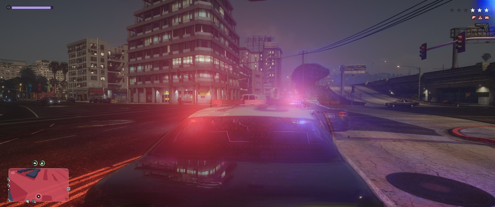
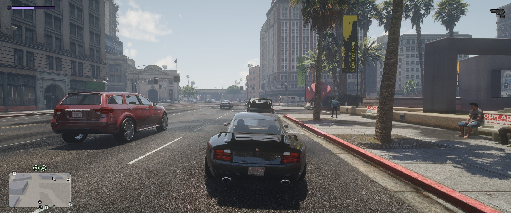
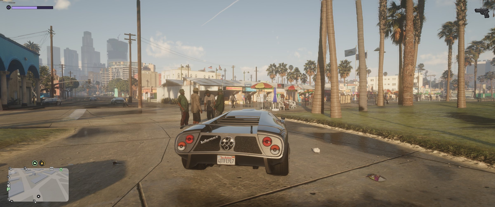
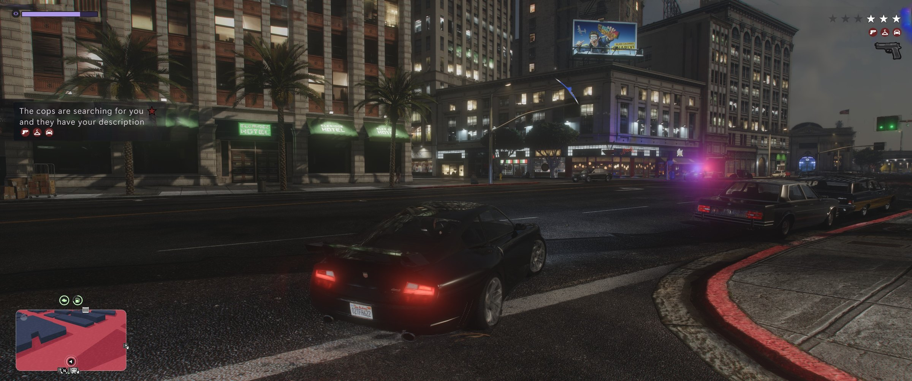
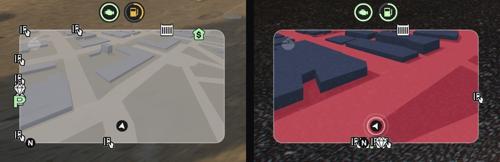
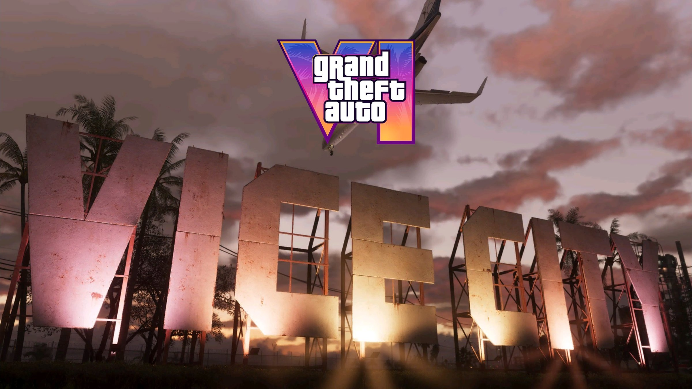
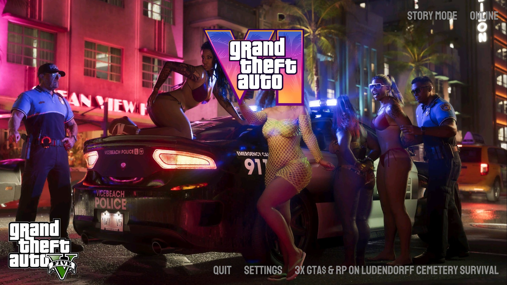
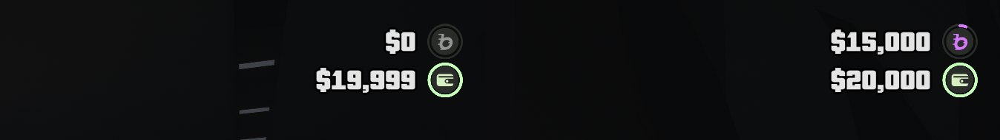

<div align="center">

# 🌴 GTA VI-Inspired HUD

**A GTA VI-style HUD and minimap for GTA V story mode on PC.**
Maintained by **Geckomacabre**. Version 2.6 adds GTA VI's character switcher, heists and police lights to the features from the [FiveM version](https://github.com/Geckomacabre/GTA-VI-UI-and-HUD-for-FiveM).

### [⬇️ Download the latest version](https://github.com/Geckomacabre/GTA-VI-Inspired-HUD/releases/latest)

### [💬 Support Discord](https://discord.gg/C7gE5SHEzH)

</div>

> [!IMPORTANT]
> ### 💬 Need help? Join our support Discord
> This version is a **fork of FBICat's VI HUD** with extra features, so it has its own support:
> **[discord.gg/C7gE5SHEzH](https://discord.gg/C7gE5SHEzH)**, or a [GitHub issue](https://github.com/Geckomacabre/GTA-VI-Inspired-HUD/issues).
> FBICat's Discord is there for his original mod, so please bring questions about this version to ours. Thank you!

> [!TIP]
> ## 🔄 Updating? Just one file
> **Already have 2.5.1 or newer?** Install the new HUD package over the old one, the same way as before:
> - **Legacy:** `GTA-VI-Inspired-HUD-2.6.5-Legacy.oiv` with OpenIV, to the **mods folder**.
> - **Enhanced:** `GTA-VI-Inspired-HUD-2.6.5-Enhanced.oiv` with the OIV Package Installer.
>
> **No more RegisterPatch:** the HUD package now switches its own packs on, so there's nothing else to install.
>
> **Game in Program Files?** Right-click OpenIV or the OIV Package Installer (`CodeWalker.OIVInstaller.exe`) →
> **Run as administrator** before you install, or the old files can stay in place.
>
> The number in the file name is the version, so you can always tell which one you have.
>
> **No need to reinstall** Script Hook V, Script Hook V .NET, OpenIV or OpenRPF.
>
> - **Your progress stays.** Saves are never touched by the package.
> - **Your settings go back to the defaults:** the package brings fresh `.ini` files, so if you changed any settings, note them down first.
> - **NaturalVision Enhanced users:** after updating, copy the `vihud` and `vihudfonts` folders from `mods\update\x64\dlcpacks` into `onigiri\dlcpacks` (replace the old `vihudfonts`), and add `<Item>dlcpacks:/vihud/</Item>` to NVE's `onigiri\common\data\dlclist.xml`, just above the closing `</Paths>` at the bottom of the file (not under `<Paths>` at the top).
>
> Coming from **2.5.0 or older**? Install the HUD package.

> **Disclaimer:** fan-made and inspired by GTA VI. Not affiliated with Rockstar Games or Take-Two.
> Some HUD art is taken from Rockstar's official GTA VI media
> ([rockstargames.com/vi/media](https://www.rockstargames.com/VI/media)) and belongs to Rockstar Games.
> No GTA VI game files are included.

---

## 📸 Screenshots


<sub>A night chase: the GTA VI police lights, the stars at the top right and the 3D minimap gone red.</sub>

<table>
<tr>
<td width="50%"><br><sub>Downtown, with the 3D minimap at the bottom left.</sub></td>
<td width="50%"><br><sub>Vespucci Beach at golden hour.</sub></td>
</tr>
<tr>
<td><br><sub>Wanted: GTA VI's stars and "the cops are searching for you".</sub></td>
<td><br><sub>The 3D minimap up close, and red while you're wanted.</sub></td>
</tr>
<tr>
<td><br><sub>FBICat's loading screens with Rockstar's Vice City pictures.</sub></td>
<td><br><sub>FBICat's start screen on GTA V Legacy.</sub></td>
</tr>
</table>


<sub>BuckMe (your bank) and your wallet at the top right. An empty one turns grey.</sub>

---

## 🆕 New in 2.6

- **GTA VI's character switcher.** Hold **Left Alt** and the characters are a row of cards, as in GTA VI: Michael,
  Franklin and Trevor, then **Jason ♥ Lucia**, each with their honor face under the card.
- **Jason on the character wheel**, next to Lucia. Neither model is included: see below for where to get them.
- **Heists.** Case and rob the **Fleeca banks**, **Pacific Standard** and **Vangelico**, then lose the police
  and stash the bag to get paid. Vangelico is open outside the story too.
- **GTA VI's police lights and police arrow**, rebuilt frame by frame from the chase in the GTA VI trailer, and
  **GTA VI's wanted box**, with the tells the police have on you (your outfit, face, plate, gun or a camera).
- **Carry every weapon, as in GTA V.** It's a switch: **CARRY ALL WEAPONS** in HUD OPTIONS (hold **V**), on by default.
  Switch it off for FBICat's limit (2 pistols, 2 long guns, 1 thrown weapon and 1 other). While it's on, **Left / Right**
  on the weapon wheel step through the weapons of a kind.
- **One file to install:** no more RegisterPatch.
- **A game in Program Files gets fixed** with one Windows prompt, so the HUD can save its settings.
- **LSPDFR:** while you're on duty, no character switching, witnesses or wanted level.
- **Lucia is no longer included:** her model is someone else's paid work. Her switching and wardrobe stay in for
  a Lucia model of your own.
- **Smoother frame times**, and a long list of fixes: all of it is in the **[changelog](CHANGELOG.md)**.

---

## 🚀 Install in 3 steps

> ⚡ **Never modded GTA?** The **[Quick start](QUICK-START.md)** is the whole install on one short page.

**1. Which GTA V do you have?** Open your GTA V folder and look:

| You see this file | You have | Your guide |
| :--- | :--- | :--- |
| `GTA5.exe` | **Legacy** | 👉 **[Legacy guide](INSTALL-LEGACY.md)** |
| `GTA5_Enhanced.exe` | **Enhanced** | 👉 **[Enhanced guide](INSTALL-ENHANCED.md)** |

**2. Download 1 file** from the [latest release](https://github.com/Geckomacabre/GTA-VI-Inspired-HUD/releases/latest):
the `.oiv` with your version's name (Legacy **or** Enhanced).

Want to play as **Lucia**? She isn't included: her model is someone else's paid work. Get her from her creator,
**[Lucia Caminos on Patreon](https://www.patreon.com/u10507693/posts/lucia-caminos-6-170646256)** or **[MP Jason & Lucia V](https://www.gta5-mods.com/player/mp-jason-lucia-v)** on gta5-mods.com, or use another Lucia model: your install guide's "Optional: Lucia" section puts her in the game, with the **Lucia kit**. For Jason, get **[Jason Duval](https://www.patreon.com/u10507693/posts/jason-duval-from-168652433)** from the same creator, or **[Jason Duval character from GTA VI](https://mod-hub.net/mod/personazh-jason-duval-z-gta-vi-dlya-gta-5/?lang=en)** on mod-hub.net. Your install guide's "Optional: Jason" section puts him in the game, with the **Jason kit**.

**3. Follow your guide.** It's written for people who've never modded GTA. Only follow the guide for
**your** version: mixing them up crashes the game.

---

## 🎮 Controls

| To do this | Press |
| :--- | :--- |
| HUD settings | Hold **V** (controller: hold the camera button). Greet / antagonize, spin-outs and the VI radio wheel switch on and off here too |
| Switch character | Hold **Left Alt** (controller: **D-pad Down**), pick with **Q / E** or **Left / Right** (controller: **LB / RB**), let go to switch. Jason and Lucia need their models *(not included: see above)* |
| Minimap | Get in a car (it also shows when you're wanted) |
| Radio | Hold GTA's radio button in a car (**Q**; controller: **D-pad Left**). **O** mutes it (controller: click the right stick while the wheel is open) |
| Your own music (On Demand) | In the radio wheel, press **Down** (controller: right stick down). **Left / Right** (right stick) switch between your stations (each folder in `CustomMusic` is one), the **mouse wheel** (D-pad Right / Up) changes the song, **Up** goes back to the radio |
| Nitrous | Hold **Left Shift** (controller: **X** / **Square**) in a car with a bottle |
| Mod your car | Drive into a **Los Santos Customs** garage and stop. Hold **Backspace** (or **B**) 2 s to leave from anywhere |
| Crouch | **Left Ctrl** twice |
| Lie down / crawl | **Right Ctrl**, then **W / S** |
| Binoculars | Hold **Tab** (weapon wheel), let go on the binoculars |
| Pick between weapons of a kind | With **CARRY ALL WEAPONS** on (HUD settings), **Left / Right** on the weapon wheel's **WEAPONS** page (D-pad, arrow keys or the mouse wheel) |
| Rob a bank or Vangelico | Case it first: walk round without aiming and look at each camera and guard until its ring fills. Then pull a gun |
| Surrender (with stars) | Look at a cop and hold **E** |
| Skills | **K** |
| Push-ups / sit-ups | **N** / **Shift + N** |
| Greet / antagonize someone | **Y** / **U** |

🙋 **Rather not greet people?** Set `GreetAndAntagonize = False` under `[Switches]`, at the top of
`scripts\ViExtras.ini`, and the Greet / Antagonize prompt stays off. Every feature has a plain True / False switch
there, and `GTA6Hud.ini` opens with FBICat's.

🎵 **Music:** none is included. Put your own `.mp3` files in `scripts\Hud\Radio\CustomMusic` and pick **On Demand** in
the radio wheel: each subfolder becomes a station of its own. Chase music goes in `scripts\Hud\Music`.

---

## ✨ What's in it

- A **GTA VI-style HUD** and a **3D minimap** with teal waypoint and pink mission routes
- **GTA VI's character switcher**, with room for **Jason** and **Lucia** next to Michael, Franklin and Trevor (their models
  aren't included)
- **Wanted stars** and **GTA VI's wanted box**, which tells you what the police know, plus **GTA VI's police lights** at
  the screen edge and its **police arrow**
- **Heists:** case and rob the Fleeca banks, Pacific Standard and Vangelico
- **Police with stun guns:** they only shoot to kill when you're armed at 3+ stars. Otherwise they tase and arrest you,
  or arrest you when you stand still, unarmed. Hold **E** near a cop to surrender
- A **radio wheel** with station logos, the song and artist, and **On Demand** for your own music
- **WASTED / BUSTED** screens, a **crash cam** and **binoculars**
- **Leonida Customs**: a full mod shop with nitrous
- **Honor**, **skills**, a **gym**, and people who **remember you**
- **Crouch and crawl**, a **crosshair with kill marks**, **Focus**, and a switch to **carry every weapon**

Everything that changed, version by version: **[changelog](CHANGELOG.md)**.

---

## ⚠️ Known bugs (being fixed)

- The minimap's waypoint route can look shaky.
- **NaturalVision Enhanced**, **Lively World Expansion**, **Central Real-Life Traffic / Environment** and **AuraV-Lite** users: follow their "Optional" sections in the [Enhanced guide](INSTALL-ENHANCED.md).

## 🆘 Something wrong?

Each install guide ends with a **"Something went wrong?"** section. Still stuck? Ask in
**[our support Discord](https://discord.gg/C7gE5SHEzH)**, the one for this version, or [open an issue](https://github.com/Geckomacabre/GTA-VI-Inspired-HUD/issues) and attach these files
from your game folder: `ScriptHookVDotNet.log`, `scripts\GTA6Hud.error.log` and `scripts\ViExtras.log`.

---

## 🙏 Credits

- **FBICat**: the HUD (first released as "VI HUD"), Lucia's character switching and wardrobe, the minimap
  additions, and everything else in this mod.
- **moddims** (Discord `@moddims`): the original "GTA VI MiniMap (3D Buildings)" mod the minimap is built
  on, including `ViMinimap.asi`.
- **Grand Figma Kit VI**: the UI design kit behind the HUD art,
  [CC BY 4.0](https://creativecommons.org/licenses/by/4.0/).
- **[LemonUI](https://github.com/LemonUIbyLemon/LemonUI)** by Lemon (MIT), included as `scripts\LemonUI.SHVDN3.dll`.
- **2.5 ports:** from [GTA-VI-UI-and-HUD-for-FiveM](https://github.com/Geckomacabre/GTA-VI-UI-and-HUD-for-FiveM)
  by Geckomacabre, and the FiveM resources it builds on:
  - **Leonida Customs** after renzu_customs by Renzuzu (GPL-3).
  - **Crouch and crawl:** the script is ported from rpemotes' crouch / crawl by Mads (GPL-3). The animations
    themselves are Rockstar's own, from GTA V; the front crawl's leg motion is reworked from Rockstar's crawl.
  - **WASTED / BUSTED** from vi_wasted (GPL-3).
  - **Nitrous** from StreetKings.
  - **NPC memory** from um_memory.
  - **The radio** after sej0bec's "VI Radio". Some station logos are from Logopedia; the stations are
    Rockstar Games' trademarks.
- **Anton** font by Vernon Adams (SIL Open Font License, `scripts\ViExtras\Radio\Anton-OFL.txt`).
- Runs on Script Hook V by Alexander Blade and Script Hook V .NET by crosire and contributors.

## License

FBICat's work, shared here with their permission, for personal use. Rockstar's artwork belongs to
Rockstar Games. Grand Figma Kit VI is under CC BY 4.0.

The 2.5 script files have their own licences:
- `ViCustoms.dll`, `ViCrouch.dll` and `ViWasted.dll` are GPL-3. Their source is in `src\`, and the licence
  ships next to them.
- The radio code is under the PolyForm Noncommercial License 1.0.0 (`scripts\ViExtras\Radio\LICENSE.md`).

<details>
<summary><b>🛠️ For modders: rebuilding the packages</b></summary>

`scripts\` and `ViMinimap.asi` in this repo are exactly what the packages install. The DLC packs are
too big for git, so they're only in the releases. Python 3.8+, no extra modules:

```bash
python tools/build_oiv.py legacy --dlcpacks path/to/legacy/dlcpacks
python tools/build_oiv.py enhanced --dlcpacks path/to/gen9/dlcpacks
```

The packages go into `build\`. The install script comes from `oiv\<edition>.xml`, and the pack registration
(`dlclist.xml` and the `gameconfig.xml` pools) from `oiv\register.xml`.

The 2.5 script files are built from `src\` (.NET Framework 4.8, `dotnet build -c Release`). Their art is
rendered from the FiveM version's pages (`tools\render_fivem_art.py`) and packed into the `vihudfonts`
pack's texture dictionaries (`tools\build_txd.py`).

</details>
